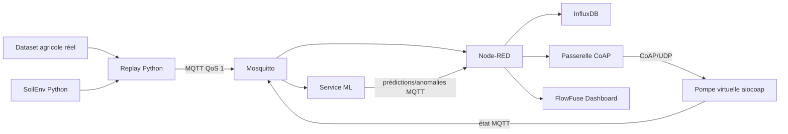
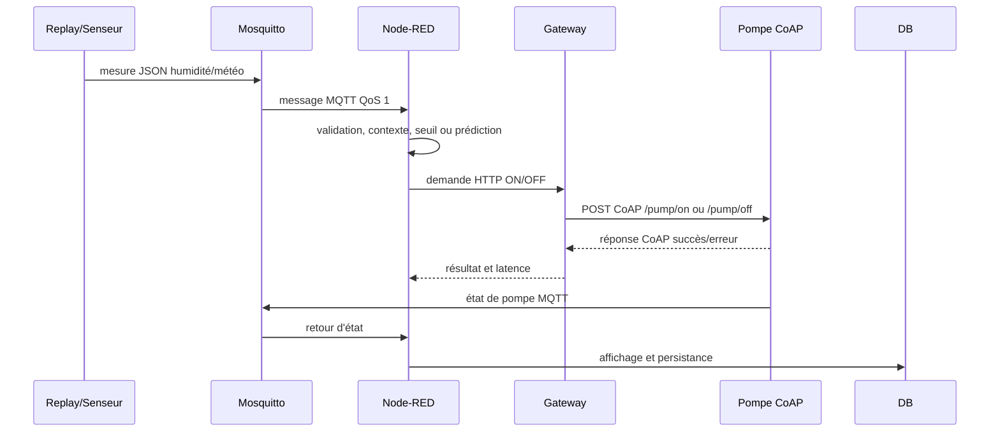

# Architecture (version de travail)

## Architecture à trois niveaux

## Cycle d'irrigation

## Topics MQTT et ressources CoAP

| Topic | Usage |
|---|---|
| `ferme/parcelle1/humidite_sol` | mesure d'humidité |
| `ferme/parcelle1/meteo` | température et pluie |
| `ferme/parcelle1/prediction` | prévisions ML |
| `ferme/parcelle1/anomalie` | alertes d'anomalie |
| `ferme/parcelle1/pompe/etat` | état de l'actionneur |

La pompe expose `POST /pump/on`, `POST /pump/off` et `GET /pump/state` sur UDP
5683. MQTT est adapté à la télémétrie asynchrone; CoAP est conservé pour la
commande légère et explicite de l'actionneur.
